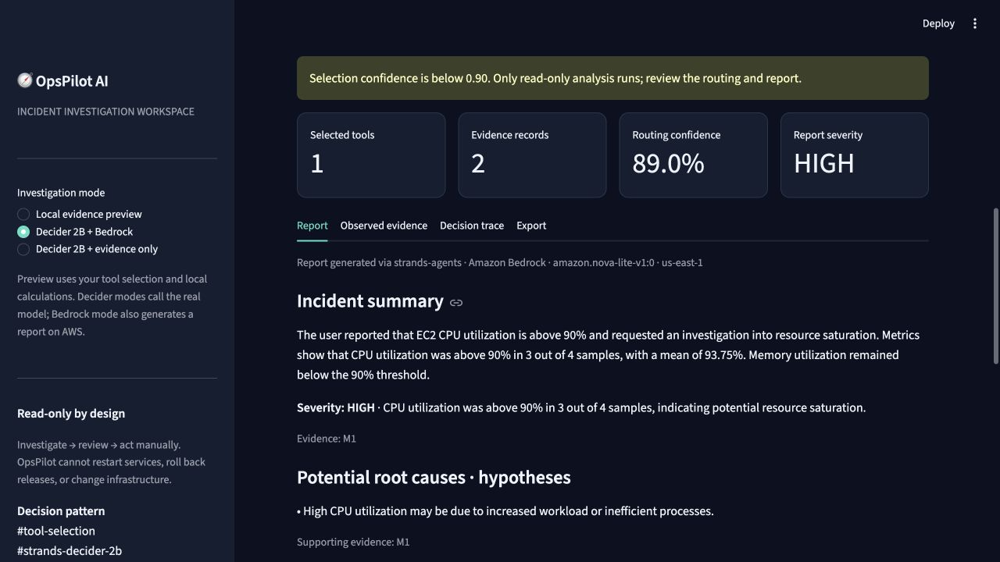

# OpsPilot AI

A read-only DevOps incident investigator. **Strands Decider 2B selects diagnostics;
Amazon Bedrock explains their observed evidence through the Strands Agents SDK.**

Pattern: **#strands-decider-2b #tool-selection** · License: Apache-2.0



The dashboard includes four synthetic incidents: CPU saturation, HTTP 500s, failed
deployment, and database timeouts. It shows the typed model decision, probabilities,
selected tools, literal evidence, causal hypotheses and missing information.

## Verified locally

71 tests passed (1 optional runtime check skipped); see current coverage in the saved test artifacts. Genuine
Decider inference passed all four fixtures; Decider + Strands + Bedrock reporting
passed CPU saturation and failed deployment. See [execution evidence](docs/verification.md).

## Run locally

Python 3.13 is used in this workspace. Create an isolated environment from the
repository root (the folder containing this README):

```bash
python3.13 -m venv .venv
source .venv/bin/activate
python -m pip install -r requirements-dev.txt
cp .env.example .env
streamlit run app.py --server.address 127.0.0.1 --server.port 8501
```

Open http://127.0.0.1:8501. **Explore sample data · no AI** works without AWS or model
weights. You manually choose tools; this mode does not claim an AI decision or
Bedrock-generated report. Select an incident and press **Investigate incident**.

## Start genuine Strands Decider 2B

Keep its runtime separate from the dashboard dependencies. On Apple silicon:

```bash
python3.13 -m venv .decider-venv
.decider-venv/bin/python -m pip install -r requirements-decider.txt
HF_HOME="$PWD/.cache/huggingface" .decider-venv/bin/strands-decider serve \
  StrandsAgents/strands-decider-2B-qwen3.5-v1-2610 \
  --device mlx --host 127.0.0.1 --port 8099 --strict-window
```

For CPU use `--device cpu`; for a supported NVIDIA environment use the official
[cuda installation guide](https://github.com/strands-labs/strands-decider/blob/d942e5515db750f80a51032629ec312455a87976/docs/inference.md).
The first model start downloads the checkpoint plus approximately 4.5 GB of base
weights. Leave the server running. The runtime is pinned to official commit
`d942e5515db750f80a51032629ec312455a87976` because MLX extras are newer than the
published 0.1.0 package described in upstream documentation.

`STRANDS_DECIDER_URL=http://127.0.0.1:8099` is the default. Only loopback endpoints
are accepted. The upstream server has no authentication; keep it local.

## Configure Bedrock

Use an AWS profile you control with access to a Bedrock text model. Do not paste
access keys into the app or repository. Set these non-secret options in `.env`:

```dotenv
OPSPILOT_AWS_PROFILE=your-profile
AWS_REGION=us-east-1
BEDROCK_MODEL_ID=amazon.nova-lite-v1:0
```

`OPSPILOT_AWS_PROFILE` takes precedence over an inherited `AWS_PROFILE`, so the
app does not accidentally use a desktop session's expired SSO profile.

`amazon.nova-lite-v1:0` was returned by the Bedrock model catalog in the selected
account. Availability depends on your account and region; the application does not
hardcode that ID. To discover models and check authentication:

```bash
.venv/bin/python -m scripts.check_access --list-models
```

Restart Streamlit after changing `.env`.

Select **Full AI investigation** to run the combined workflow, or **AI tool selection only** to verify routing without generative AWS calls. Synthetic telemetry
is analyzed locally; only the incident and selected observed evidence go to Bedrock.
See [security and least privilege](docs/security.md).

## Reproduce checks and demonstrations

```bash
.venv/bin/python -m pytest -q --cov=src --cov-report=term-missing
.venv/bin/ruff check .
.venv/bin/ruff format --check .
.venv/bin/python -m scripts.run_demo --mode preview --output artifacts/preview-results.json
.venv/bin/python -m scripts.run_demo --mode decider --output artifacts/decider-results.json
.venv/bin/python -m scripts.run_demo --mode bedrock \
  --scenario 'CPU saturation' --scenario 'Failed deployment' \
  --output artifacts/bedrock-results.json
```

The last two commands invoke the real model; the Bedrock command incurs model
usage charges. Test doubles in offline tests verify contracts and error handling,
not live model availability. A run with no generated report is not a completed
Bedrock integration verification. Actual results are recorded in
[verification](docs/verification.md) and [execution checklist](CHECKLIST.md).

## Read the dashboard

See the [plain-language dashboard guide](docs/dashboard-guide.md) for the meaning
of urgency, tool choice certainty, cause confidence and evidence IDs. The UI
separates observations from possible explanations and clears old findings when
you change the inputs.

## How it works

1. Validate bounded, timezone-aware telemetry and label its source.
2. Ask local Decider a typed four-option primary-tool question and three independent
   relevance questions in one HTTP request.
3. Validate checkpoint identity, probability distribution, choice and confidence.
4. Abstain for `clarify` or confidence below 0.35; otherwise execute the primary
   tool and other tools with P(relevant) >= 0.80. Flag primary confidence below 0.90.
5. Generate a Pydantic report with Strands `Agent` / `BedrockModel`, no operational
   tools, and only the selected tools' facts.
6. Reject unknown evidence references. Display observed facts separately from
   generated hypotheses and export the full trace as JSON.

Metric thresholds and deployment time windows are explicit demo heuristics, not
service SLOs or proof of a root cause. Missing logs are not evidence of health.
Evidence-reference checks do not prove semantic correctness. Humans review reports
and approve any operational changes outside this app.

## Project map

- `app.py`: Streamlit dashboard, JSON telemetry editing and export.
- `src/decider.py`: reusable typed decision pattern and validated HTTP client.
- `src/agent.py`: selection-to-execution orchestration seam.
- `src/bedrock_analyzer.py`: real Strands/Bedrock structured reporting.
- `src/tools/`: three deterministic read-only analyzers.
- `src/data/sample_incidents.py`: fixed synthetic fixtures.
- `tests/`: tools, boundaries, model contract, workflow and dashboard checks.
- `docs/architecture.md`: architecture diagram and trust boundaries.
- `docs/decision-pattern.md`: reusable pattern, thresholds and adaptation guide.
- `docs/builder-center-article.md`: article draft for review before publishing.
- `docs/demo-script.md`: timed public-demo recording script.
- `docs/submission-checklist.md`: official requirements and outstanding actions.

## Troubleshooting

- **Decider unavailable:** start the official server and wait for model loading;
  keep the model ID/checkpoint exact. No mocked fallback is used.
- **Token window exceeded:** reduce incident/excerpt size; the server uses strict
  window mode so oversized prompts fail instead of silently losing evidence.
- **AWS authentication expired:** refresh your chosen profile (for SSO, use
  `aws sso login --profile your-profile`).
- **AccessDenied / reporting error:** verify `bedrock:InvokeModel`, model access,
  region and supported tool/structured-output capability. Evidence remains visible.
- **Validation rejection:** inspect your input units/timezones or the exported
  report/decision trace. Never relabel an invalid or failed run as successful.

## Hackathon status

This repository prepares a submission; publication, eligibility verification,
video recording/upload, article publication and final submission remain explicit
review actions. See the checklist for current evidence. No latency savings or
accuracy improvement over an LLM is claimed.

For an honest synthetic-input demonstration and recorded AWS integration evidence,
see [Hackathon proof and demo steps](docs/hackathon-proof.md). The dashboard now
includes an **Integration proof** tab with service receipts for newly generated runs.

## Live AWS data and cleanup

Select **Live AWS EC2 metrics**, choose a profile/region, connect, select an
instance and UTC time window, and fetch real CPU averages. **Full AI investigation**
uses that snapshot with Decider and Bedrock. No memory, application logs or release
events are collected in live mode. The dashboard does not provision infrastructure.
See [AWS usage and cleanup](docs/aws-usage-and-cleanup.md), including the separately
authorized disposable EC2 test and its recorded cleanup status.
