# OpsPilot AI architecture

```mermaid
flowchart LR
    I[Incident + labeled telemetry] --> UI[Streamlit input validation]
    UI -->|Real AI mode| D[Local Strands Decider 2B]
    D --> Q[Typed choice + three relevance questions]
    Q -->|Low confidence or clarify| A[Abstain: ask for more information]
    Q -->|Validated allowlist| T[Read-only diagnostic tools]
    UI -->|Explicit manual preview| T
    T --> E[Observed evidence IDs + limitations]
    E -->|AI mode only| S[Strands Agent / BedrockModel]
    S --> B[Amazon Bedrock structured report]
    B --> V[Schema + evidence reference validation]
    E -->|Explicit sample-report mode| P[Local evidence formatter: no Bedrock call]
    P --> PV[Sample schema + evidence ID validation]
    PV --> R[Dashboard + JSON export]
    E --> R
    V --> R
```

## Execution boundary

`src/agent.py:investigate` is the enforced decision seam. It requests a real Decider
selection, executes only tools in the returned allowlisted selection, then hands
those results to the Bedrock reporting agent. Decider does not generate prose.
Bedrock does not select diagnostic tools and has no operational tools available.

The three diagnostics analyze supplied data in memory; none executes shell commands
or alters AWS resources. Their outputs are deterministic. Sample telemetry is
synthetic and fixed. The CloudWatch collector reads EC2 inventory and CPU averages for an explicit account, instance and UTC window. It does not discover deployed applications, read memory, or collect application logs. Saved AWS snapshots retain the original collection time and are not live refreshes.

## Data contracts

Input is a timezone-aware incident with bounded lists of metrics, log entries and
deployment events. Supported metrics have explicit units in their names; percent
values are constrained to [0,100]. Missing data is retained as an explicit limitation.

Facts receive stable IDs within a run (`M1`, `L1`, `D1`, etc.). The UI displays
observed facts from the tools directly, separate from generated causal hypotheses.
The report includes severity, rationale, root-cause hypotheses, causal confidence,
uncertainty, next steps and missing information. Every finding is checked against
the run's evidence ID set. A real ID does not establish that a generated sentence
is entailed by it: the engineer still reviews interpretations.

## Failures

- Invalid JSON, values or timestamps: reject before inference.
- Wrong Decider checkpoint/model, bad probabilities or HTTP errors: fail closed;
  never replace with a keyword router or an ordinary LLM.
- Decider abstention: no diagnostics and no Bedrock charge.
- Bedrock denial, unavailable model or invalid report: preserve diagnostic evidence
  and show the reporting error, with no fabricated substitute.
- Manual preview: clear label; no AI decision, severity or root-cause report.

## Trust and limits

The local server identity check verifies reported checkpoint metadata; it is not
cryptographic attestation. Keep the server under your control on loopback. Upstream
has no authentication. Incident/log text is treated as untrusted input in prompts;
this does not eliminate prompt injection. The fixed tool allowlist and lack of
operational capabilities bound its impact. No production reliability or routing
accuracy claim is made from four examples.

## Explicit sample-report path

`SampleReportGenerator` is selected only when the user chooses **Demo report · real
Decider 2B**. `investigate()` still calls the same real `DeciderClient.select()` and
runs only the returned allowlisted diagnostics. A local deterministic formatter
then turns those observed results into a Pydantic report with citations and next
checks. It does not guess severity or root cause: severity is unknown, confidence
is low, and causal hypotheses are empty. Its metadata says `report_kind=sample`,
`bedrock_called=false`, and contains no AWS reporting receipt. The dashboard,
report body and JSON export label that provenance. There is no silent fallback
from a failed Bedrock call to this mode.

The genuine Bedrock path remains `strands.Agent` + `strands.models.BedrockModel`,
ConverseStream on the regional `bedrock-runtime` endpoint. It submits only selected
evidence and uses a structured report schema whose validator checks evidence IDs
and conservative causal confidence. Six SDK turns are permitted; automatic retries
are disabled. A denied or invalid report is not accepted as success. The current
bhoomil account restriction and exact service response are in `docs/bedrock-diagnosis.md`. Temporary authorized hardik/us-east-1 runs succeeded with the same SDK, model and validation path; profile, actual endpoint and AWS receipts are recorded separately from the input-data source.
